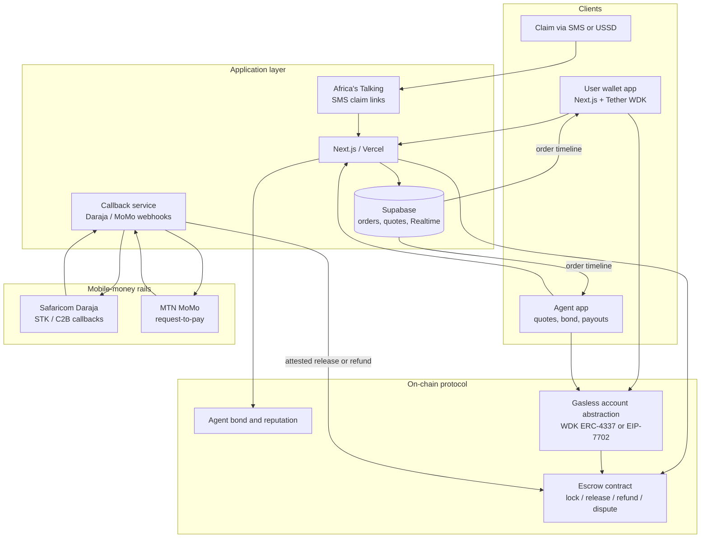

# Wakala

**Turn every mobile-money agent into a dollar ATM.**

> **Working name.** *Wakala* is a provisional project name. It is Swahili for “agent” and is likely already used by other products; it has not been cleared for trademark or domain conflicts and may change before a public launch.

Wakala is a self-custodial USD₮ wallet that swaps between USD₮ and mobile money (M-Pesa, MTN MoMo and, later, other rails) through nearby agents or peers. The USD₮ is locked in an **escrow smart contract** and is released only when the mobile-money payment is **confirmed by the provider or by the recipient** — never on the strength of a screenshot or a forged SMS alert.

This repository is being prepared for the **W3Node Node Engine** hackathon in Cape Town, **12–14 November 2026**, on the **Mobile Money & Peer-to-Peer** track, which is sponsored by **Tether** (USD₮ and the [Wallet Development Kit](https://docs.wdk.tether.io/)).

**Team:** Usman Olukayode.

## The problem

Africans already move enormous value on mobile money, and many already hold dollar stablecoins. The join between the two is still slow, expensive or unsafe.

- Sub-Saharan Africa had **17 million registered mobile-money agents** in 2024, of whom only **38% were active on a monthly basis**, and agents digitised **US$356 billion** that year. This is a large, under-used cash-in and cash-out network. ([GSMA, State of the Industry Report on Mobile Money 2025, regional cuts](https://www.gsma.com/solutions-and-impact/connectivity-for-good/mobile-for-development/wp-content/uploads/2025/10/SOTIR-2025-Regional-Cuts_r-1.pdf))
- The World Bank’s Remittance Prices Worldwide database puts the average total cost of sending **US$200 to Sub-Saharan Africa at 8.46% in the third quarter of 2025** — **the highest of any receiving region** (fees plus exchange-rate margin). ([World Bank RPW resources](https://remittanceprices.worldbank.org/resources); [African Exponent summary of Issue 54](https://www.africanexponent.com/chart-of-the-day-sending-200-home-to-sub-saharan-africa-costs-8-46-percent/))
- Between July 2024 and June 2025, Sub-Saharan Africa received **more than US$205 billion** in on-chain value, up about **52%** year on year. **Stablecoins accounted for 43%** of the region’s crypto transaction volume in the prior reporting cycle cited by Chainalysis. ([Chainalysis, 2025 Geography of Cryptocurrency](https://www.chainalysis.com/blog/subsaharan-africa-crypto-adoption-2025/); [Cointelegraph](https://cointelegraph.com/news/sub-saharan-africa-third-fastest-growing-region-crypto-adoption-report))
- Centralised P2P desks are both concentrated and fragile. **Binance discontinued all Nigerian naira (NGN) services, including P2P, in 2024.** ([Binance announcement](https://www.binance.com/en/support/announcement/binance-to-discontinue-all-nigerian-naira-ngn-services-f9857dc2fea4448ba1fb8815d87d8144)) Fake payment screenshots and SMS alerts remain a common P2P scam pattern. ([Techeconomy](https://techeconomy.ng/p2p-risks-vendor-scams-threaten-cryptos-role-as-a-payment-system-in-nigeria))
- **Smartphones accounted for 63% of mobile connections** in Sub-Saharan Africa in 2025, so about **37% of connections are still not smartphones**. ([GSMA, Accelerating Smartphone Adoption in Africa](https://www.gsma.com/about-us/regions/africa/wp-content/uploads/2025/11/GSMA-SmartPhone_Adoption_Report_final.pdf))

People paid in USD₮ need local currency in minutes. Agents hold idle float. Existing P2P markets often release crypto when a human clicks “I have been paid”, which is exactly where screenshot fraud lives.

## The solution

Wakala makes the **agent network** the on- and off-ramp, with **programmable escrow** as the trust layer:

- Users hold USD₮ in a **self-custodial WDK wallet** (gasless on EVM via account abstraction).
- A swap locks USD₮ in escrow. Release happens only after a **mobile-money provider callback** (for agents connected to Daraja or MoMo) or after an in-app **recipient confirmation**, with a timeout and a dispute window (for smaller agents).
- Agents post a **USD₮ bond**. Reputation is recorded on-chain, and limits grow with a clean history. A lost dispute can slash the bond.
- Users can **send USD₮ to a phone number**. The recipient claims by SMS link (USSD is a stretch goal) and can cash out at an agent.

The product is designed to work worldwide wherever agents and mobile money (or similar instant rails) exist, and is aimed first at East, West and Southern Africa.

## Core user flow (cash-out)

1. Amina taps **“Cash out 50 USD₮ → M-Pesa”** and sees live quotes from nearby agents or peers, with rating, bond and typical speed.
2. She selects Joseph. Her **50 USD₮ is locked in escrow** (gasless, via WDK).
3. Joseph sends Kenyan shillings to Amina’s M-Pesa.
4. **Release is triggered in one of two ways:**
   - a **provider callback** from Daraja or MoMo, after which the backend attests and the contract releases; or
   - Amina’s in-app **“I received it”** confirmation, with a timeout and an open dispute window.
5. The escrow pays Joseph. Both parties receive a receipt, and ratings update.

**Cash-in** runs in reverse: the agent pre-locks USD₮, the user pays the agent’s till, and the callback releases USD₮ to the user.

A **send-to-number** path holds funds in claim escrow until the recipient authenticates and, if they wish, cashes out.

## Architecture



Protocol state machines are specified in [`docs/WHITEPAPER.md`](docs/WHITEPAPER.md). Product requirements are in [`docs/PRD.md`](docs/PRD.md).

## Tech stack

| Layer | Choice |
| --- | --- |
| Application | Next.js (App Router), TypeScript, deployed on [Vercel](https://vercel.com/) |
| Data and auth | [Supabase](https://supabase.com/) (Postgres, Auth, Realtime, Edge Functions for webhooks) |
| Wallets | [Tether WDK](https://docs.wdk.tether.io/), [`@tetherto/wdk-wallet-evm-erc-4337`](https://docs.wdk.tether.io/sdk/wallet-modules/) or `wdk-wallet-evm-7702-gasless`. Confirm browser support on day one; fall back to the [WDK React Native / Expo quickstart](https://docs.wdk.tether.io/) if needed |
| Protocol | Solidity escrow, bond and (later) claim contracts, tested with [Foundry](https://book.getfoundry.sh/) |
| Mobile money | Safaricom Daraja sandbox (STK Push and callbacks); MTN MoMo sandbox as a follow-on rail |
| Messaging | [Africa’s Talking](https://africastalking.com/) for claim SMS; USSD as a stretch goal |
| Stablecoin | USD₮, in line with Tether’s sponsorship of this track |

## Planned repository structure

The application has not been scaffolded yet. The intended layout is:

```
wakala/
├── README.md
├── LICENSE
├── CONTRIBUTING.md
├── docs/
│   ├── PRD.md
│   └── WHITEPAPER.md
├── apps/
│   └── web/                 # Next.js user and agent experience
├── packages/
│   ├── protocol-sdk/        # Typed contract clients and order helpers
│   └── ui/
├── contracts/               # Foundry: escrow, bond, disputes
├── supabase/                # Schema, policies, callback edge functions
└── .gitignore
```

## Getting started

> **TODO — placeholders only.** The application and contracts have not been initialised. The commands below are the intended developer path and will fail until the scaffold exists. Do not treat them as working instructions yet.

```bash
# TODO: clone this repository
git clone <repository-url>
cd wakala

# TODO: install dependencies (package manager to be confirmed)
pnpm install

# TODO: copy environment template and fill in local values
cp apps/web/.env.example apps/web/.env.local
# Required once scaffolded, among others:
#  NEXT_PUBLIC_SUPABASE_URL=
#  NEXT_PUBLIC_SUPABASE_ANON_KEY=
#  SUPABASE_SERVICE_ROLE_KEY=
#  NEXT_PUBLIC_CHAIN_ID=
#  NEXT_PUBLIC_ESCROW_ADDRESS=
#  NEXT_PUBLIC_BOND_ADDRESS=
#  NEXT_PUBLIC_USDT_ADDRESS=
#  DARAJA_CONSUMER_KEY=
#  DARAJA_CONSUMER_SECRET=
#  CALLBACK_SIGNING_KEY=
#  AT_API_KEY=
#  WDK / paymaster configuration

# TODO: start the Next.js app
pnpm --filter web dev

# TODO: apply the Supabase schema locally
# supabase start && supabase db reset

# TODO: run an Anvil chain, deploy mock USD₮ and the escrow, then test
cd contracts
anvil
forge test
forge script script/Deploy.s.sol --rpc-url http://127.0.0.1:8545 --broadcast
```

Never commit seed phrases, paymaster keys or mobile-money secrets. Record a backup demo video of a successful callback release, and of a screenshot “payment” that does **not** release funds.

## Roadmap (three-day hackathon scope)

| Priority | Scope |
| --- | --- |
| **Must have** | WDK wallet (create, receive, send); escrow contract; quote and order book; cash-out with M-Pesa sandbox callback auto-release; Realtime order timeline; bonded agent profile; public deployment |
| **Nice to have** | Cash-in flow; send-to-phone-number claims over SMS; USSD claim; disputes and bond slashing; agent map |
| **Later** | Additional corridors and rails; tiered identity checks; bulk payouts for platforms that pay freelancers |

Day-by-day milestones and MoSCoW requirements are in the [PRD](docs/PRD.md). Build cash-out first; resist scope creep.

## Hackathon

| | |
| --- | --- |
| Event | W3Node Node Engine, Cape Town |
| Dates | 12–14 November 2026 |
| Venue | Parkview Event Space, Woodstock, Cape Town |
| Track | Mobile Money & Peer-to-Peer — “Stablecoin and peer-to-peer payment solutions built for markets where mobile-first settlement outpaces traditional banking.” ([w3node.io/node-engine](https://w3node.io/node-engine)) |
| Track sponsor | Tether — USD₮ and WDK. ([W3Node announcement](https://www.linkedin.com/posts/w3node-sa_w3node-w3node2026-tether-activity-7519043780336005121-98yT)) |
| Judging | A numeric rubric was published for Merchant & Machine Payments (Product design 33% · Technical UX 34% · Business / market fit 33%). This track is **assumed** to be judged similarly until the organisers confirm otherwise. Official selection language emphasises real-world problems, a builder mindset and technical proficiency. ([w3node.io/node-engine](https://w3node.io/node-engine)) |
| Official site | [w3node.io](https://w3node.io/) |

## Licence

[MIT](LICENSE) © 2026 Usman Olukayode.

## Further reading

- [Product requirements](docs/PRD.md)
- [White paper](docs/WHITEPAPER.md)
- [Contributing](CONTRIBUTING.md)
