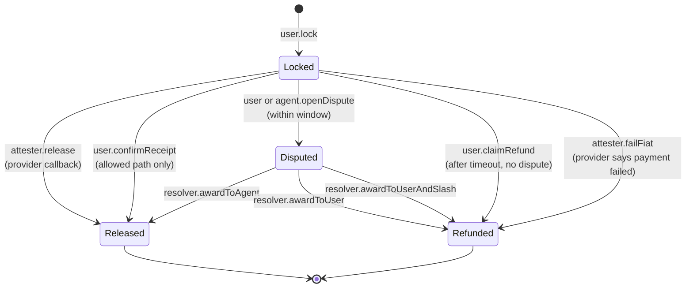
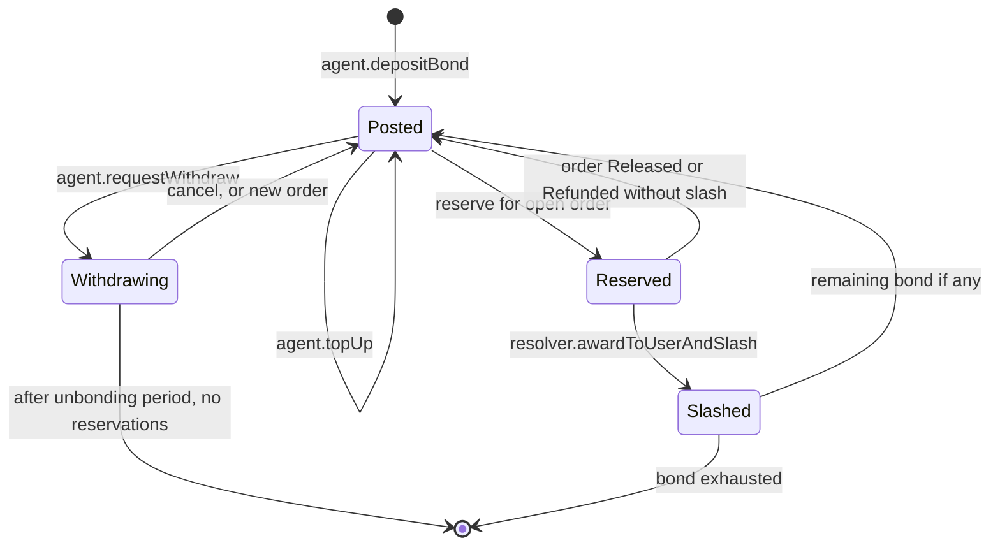

# Wakala: Escrowed USD₮ and Mobile-Money Exchange over Agent Networks

**A technical white paper (draft)**  
W3Node Node Engine, Mobile Money & Peer-to-Peer track (sponsored by Tether)  
Cape Town, 12–14 November 2026  

**Author:** Usman Olukayode  
**Working name:** Wakala is provisional. It is Swahili for “agent”, is likely already in commercial use, and has not been cleared for trademark or domain conflicts.  
**Licence:** MIT © 2026 Usman Olukayode. This paper describes a system under construction. It is not an offer of exchange, brokerage, or money-transmission services, and it is not legal advice.

---

## Abstract

Dollar stablecoins are widely used in Sub-Saharan Africa, and mobile money is the region’s default retail payment system, yet moving value between the two still often means trusting a chat-window counterparty or a centralised P2P desk. Screenshot and false-alert fraud is common; some desks have also withdrawn local-currency services entirely. Wakala is a self-custodial USD₮ wallet, built with Tether’s Wallet Development Kit, that swaps USD₮ and mobile money through agents. The USD₮ leg is locked in a smart-contract escrow and is released only when a mobile-money **provider callback** attests that the fiat leg was paid, or when the **recipient confirms** in-app under a timeout and dispute regime. Screenshots are not proofs. Agents post a USD₮ bond that can be slashed after a lost dispute. This paper presents sourced market context, the problem, the system design, the escrow and bond state machine, the security and custody model, regulatory limits, a cautious fee discussion, go-to-market, roadmap and limitations.

## 1. Market context

**Mobile money is large, and agents are its physical network.** The GSMA’s *State of the Industry Report on Mobile Money 2025* (regional cuts) records **17 million registered agents** in Sub-Saharan Africa in 2024, of whom **38% were active on a monthly basis**, and **US$356 billion digitised by agents** that year. Regional mobile-money transaction value reached **US$1.1 trillion**. The broader GSMA 2025 industry report puts Sub-Saharan Africa at **1.1 billion registered accounts** and **283 million 30-day active accounts**, with **80 billion transactions** and **US$1.1 trillion** in value for 2024 (Africa as a whole is reported similarly, with 286 million 30-day accounts and 81 billion transactions).[1]

**International transfers into the region remain expensive.** The World Bank’s Remittance Prices Worldwide (RPW) Issue 54, covering the third quarter of 2025, is reported as putting the average total cost of sending **US$200 to Sub-Saharan Africa at 8.46%** — the **highest average among receiving regions** — against a reported global average of **6.36%**. The Sustainable Development Goal target of 3% by 2030 remains far off on that measure. RPW official issue files are listed by the World Bank; the 8.46% regional figure is cited here from secondary summaries of Issue 54, not from a re-tabulation of the microdata.[2]

**Stablecoins already carry a substantial share of regional on-chain activity.** Chainalysis reports that Sub-Saharan Africa received **more than US$205 billion** in on-chain value between July 2024 and June 2025, about **52%** higher than the previous year, with Nigeria the largest national market at **US$92.1 billion** received. Coverage of the same research cycle states that **stablecoins accounted for 43%** of the region’s crypto transaction volume in the prior reporting period. Retail-sized transfers are relatively more common than in the rest of the world (over 8% of value in transfers under US$10,000, versus 6% elsewhere, in the 2024–25 window).[3]

**The consumer device mix is still mixed.** GSMA’s 2025 smartphone-adoption work reports that **smartphones accounted for 63% of mobile connections** in Sub-Saharan Africa in 2025, implying that about **37% of connections are not smartphones**.[4] Any P2P design that assumes a high-end app-only user will exclude a large minority. A full USSD wallet is not Wakala’s first deliverable, but send-to-number and SMS or USSD claim paths exist for that reason.

**Intra-African payment friction is a related, longer-term backdrop.** Afreximbank and AfCFTA officials have estimated that routing intra-African payments through third currencies costs the continent on the order of **US$5 billion a year**. That figure is an official estimate from 2022 launch remarks around the Pan-African Payment and Settlement System, not a Wakala impact claim.[5]

Taken together: agents, mobile money, and USD₮ already exist. The unreliable, sometimes vanishing, join between them is the product gap.

## 2. Problem analysis

A freelancer paid in USD₮ who needs Kenyan shillings tonight has a short menu. She can use a centralised exchange with a local rail, a licensed ramp, or a peer. Each path has a failure mode.

**Counterparty fraud.** Informal P2P still often releases crypto when the seller is persuaded that the fiat arrived. Nigerian reporting continues to describe screenshot and fake-alert scams as a practical threat.[6] Any design that includes a “I uploaded a receipt, please release” button as an authoritative proof has not solved the problem.

**Platform withdrawal.** In 2024, Binance **discontinued all Nigerian naira services, including P2P**.[7] Concentration in a single desk is an operational and political risk, not only a fee risk.

**Cost.** An 8.46% average for a US$200 formal remittance to the region is the public benchmark Wakala has to beat on corridors it actually serves, after spreads and cash-out fees, before any advertising claim is made.[2] This paper does not assert that the protocol already does so.

**Idle agent float.** Millions of agents already monetise cash-in and cash-out.[1] They are a distribution network. They are under-used as a regulated-adjacent off-ramp for dollar tokens, especially if the crypto leg can be locked before they part with e-float.

**Custody and consumer wallets.** MiniPay and ramp partners (Yellow Card, OneRamp and others) show demand for stablecoin wallets with mobile-money on-ramps in selected countries.[8] Kotani Pay, Yellow Card’s APIs and Fonbnk provide institutional rails.[9] Machankura offers Bitcoin over USSD, with public figures in 2025 of the order of **15,000 users** in **eight or nine** African countries — an important inclusion precedent, but a Bitcoin and often custodial one, not a USD₮ escrow marketplace.[10] Wakala’s differentiation is **self-custodial USD₮, agent-network liquidity, and escrow that ignores screenshots**.

## 3. System design

Wakala has four parts.

**Wallet client.** A Next.js application (Vercel) uses Tether WDK to create and operate a self-custodial account on an EVM chain, preferably through an ERC-4337 or EIP-7702 module so USD₮ transfers and escrow calls can be gasless.[11] If WDK does not bundle cleanly for the browser, the documented fallback is WDK’s React Native quickstart; the protocol does not depend on a particular UI shell.

**Marketplace application.** Supabase stores profiles, quotes, orders and events, and pushes Realtime status to both parties. The database is not the custodian. It may not authorise a release except by relaying an already-valid chain transaction or an attester signature allowed by the contract.

**Callback service.** A public HTTPS endpoint receives Daraja or MoMo webhooks, verifies them, maps them to an order, and submits an attestation (or a user-operation) that the escrow contract will accept. The service is trusted for **fiat-leg observation**, not for discretionary seizure of funds (see Section 5).

**On-chain protocol.** Two modules, which may be one contract or two: **Escrow** and **Bond**. A later **Claim** module can hold USD₮ for a phone number until a recipient authenticates.

Chain and official USD₮ (or testnet mock) addresses are chosen at kick-off, taking sponsorship quests into account.

## 4. Protocol design: escrow and bond state machine

### 4.1 Roles

| Role | Authority |
| --- | --- |
| **User (maker on cash-out)** | Locks USD₮; may confirm receipt on the recipient-confirm path; may open a dispute in the window; receives a refund on timeout or a successful dispute. |
| **Agent (taker on cash-out)** | Accepts a live order only after lock; pays the fiat leg; receives USD₮ on release; posts and risks a bond. |
| **Attester** | A key (hackathon: a server key) that may call `release` or, in narrow cases, `failFiat` only if the contract’s rules allow, typically after a verified provider callback. It cannot withdraw arbitrary balances. |
| **Resolver** | A separate key or committee that settles disputes. For the hackathon this may be a clearly labelled admin key. That is a centralisation limitation, not a feature to be hidden. |
| **Protocol fee recipient** | Receives a configured fee on successful release, if non-zero. |

### 4.2 Order identifiers and amounts

Each order has a `bytes32 orderId` (hash of user, agent, asset, amounts, rail, destination fingerprint, nonce and deadline). The contract stores:

- `user`, `agent`, `asset` (USD₮), `amount`, `fee`
- `state`
- `lockedAt`, `timeout`, `disputeWindow`
- `bondLocked` (amount of the agent’s bond reserved for this order, if any)

Minimum and maximum amounts, and a maximum fee, are enforced on-chain.

### 4.3 Escrow states

**Locked.** On `lock`, the user’s USD₮ (`amount + fee` if the user pays the fee) moves into the escrow. The order is bound to an agent if the marketplace already matched them, or is bound in a second `accept` call. Funds cannot be swept by the attester in this state except through `release` or `failFiat` as specified.

**Released.** USD₮ net of fee is paid to the agent. This is the unique success terminal state. `release` requires either:

- a valid attestation that `railTxId` paid `destination` the agreed local amount, and that this `railTxId` has not been used before (on-chain or in the attester’s replay cache, with the contract storing `railTxId` when provided); or
- `confirmReceipt` from the user, and only if the order was created with `path = RecipientConfirm`.

A screenshot hash, a free-text memo, or an unauthenticated “agent says paid” flag is **not** a valid argument.

**Refunded.** USD₮ returns to the user after timeout (`claimRefund` when `block.timestamp >= lockedAt + timeout` and no open dispute), after `failFiat`, or after a resolver decision.

**Disputed.** Either party may open a dispute before `lockedAt + timeout + disputeWindow` (exact bounds configurable). While disputed, refund and release are paused until the resolver acts. Evidence lives off-chain; the chain records the decision.

Transitions are mutually exclusive. Foundry tests must include: double `release`, `release` after refund, `confirmReceipt` on a callback-only order, `claimRefund` before timeout, replayed `railTxId`, and a non-attester calling `release`.

### 4.4 Bond states

An agent must have unreserved bond ≥ a required minimum to accept orders above a size threshold. On `awardToUserAndSlash`, a configured fraction or a capped amount of bond is transferred to the user (and/or a penalty address). Withdrawal is delayed by an unbonding period so that an agent cannot flee a brewing dispute.

Public profile data: posted bond, reserved bond, completed count, slashes. A simple reputation score may be computed off-chain in the first version.

### 4.5 Cash-out and cash-in mapping

**Cash-out (must-have):** user is the locker; agent receives USD₮ on release; fiat moves from agent to user via mobile money.

**Cash-in (should-have):** agent pre-locks USD₮; user pays the agent’s till; provider callback releases USD₮ to the user. States are the same; roles swap in the UI, not necessarily in the contract (a single `lock(role)` design is acceptable).

**Send-to-number (should-have):** a `Claim` escrow holds USD₮ until a phone-authenticated recipient calls `claim` or routes the order into a cash-out. Authentication in the demo may be an SMS one-time link; USSD is later. This path must not weaken the anti-screenshot rule when a subsequent cash-out occurs.

### 4.6 Provider callbacks

The attester accepts a webhook only if:

- it comes from a configured provider (shared secret, signature, or IP allow-list as available);
- the amount, currency and destination match the order within a documented tolerance (usually zero);
- the provider transaction identifier has not been used;
- the order is `Locked`.

It then submits `release(orderId, railTxId)` or `failFiat(orderId, railTxId)`. The chain remains the ledger of funds. If the attester is down, funds stay locked until timeout refund or a later attestation.

## 5. Security and trust model

**What users trust today.** (1) The escrow and bond bytecode. (2) USD₮ issuer and the chosen chain. (3) The mobile-money operator’s truthfulness about the fiat leg. (4) The attester key, for translating (3) onto (1). (5) The resolver, if a dispute is opened. (6) The client and paymaster, for not leaking keys or censoring user-operations indefinitely.

**What users should not have to trust.** A counterparty’s screenshot, SMS image, or chat message. The marketplace database acting alone. A member of the team “manually releasing” because the demo is running late — that path must not exist in the contract ABI.

**Attester compromise.** A stolen attester key could attempt to release without a real fiat payment, or to call `failFiat` incorrectly. Mitigations: key held in a narrow environment; contract-level checks (order must be locked, railTxId unique); optional delay; planned upgrade to multi-signature, provider-signed attestations, or two independent observers. This is the main honest residual risk of the v1 design.

**Resolver compromise.** A dishonest resolver can pick a winner and slash unfairly. In the hackathon this is accepted and labelled. A later design should use time-locked panels, appeal, or narrower automatic rules (for example, a matching provider callback always wins over a dispute).

**Smart-contract risk.** Re-entrancy, arithmetic, and token-return quirks (USD₮’s historical transfer behaviour) must be tested. An unaudited contract should not hold material mainnet value.

**Client risk.** Phishing, compromised NPM packages, and malicious WalletConnect sessions are in scope for operational hygiene, not all solvable in three days.

## 6. Custody and regulatory considerations

Wakala is software for a **P2P or agent-assisted crypto-fiat swap**. In many jurisdictions that activity is regulated. The project does not hold a licence, and the paper does not claim one.

Principles for any public launch:

- **User USD₮ remains in user-controlled wallets** or in the escrow contract under published rules. The operator should not pool user funds in a hot wallet “for convenience.”
- **Agents and licensed ramps** are the parties that handle fiat, subject to their own mobile-money and payments rules.
- **KYC/AML, travel-rule, sanctions and consumer disclosures** are required in many markets before retail advertising. The hackathon demo may use test accounts and must not be described as a compliant exchange.
- **Peer agents** should be visually distinct from professional agents so the UI does not imply a licence they do not have.
- **Data protection** applies to phone numbers, transaction metadata and location data if a map is added.

Nigeria’s experience with the withdrawal of Binance NGN services is a reminder that policy can change quickly.[7] Corridor design should be modular so that a rail can be paused without rewriting escrow.

This section is not legal advice.

## 7. Economic model and fees

A working commercial sketch, not a committed tariff and not a forecast:

- A **protocol fee** in the region of **0.3–0.5%** of USD₮ notional on successful release, configurable on-chain and able to be set to zero during the event.
- **Agents earn the spread** they quote, net of mobile-money tariffs they already pay.
- Later, **bulk payout** features for platforms that pay freelancers.

No volume, revenue or margin figure is claimed. Any comparison with the 8.46% RPW average must use a like-for-like corridor, include cash-out and FX, and be measured, not assumed.[2]

Bond yield is not part of the v1 design (posted bond sits as security, not as a yield product).

## 8. Go-to-market

The first corridor should be one where a developer-accessible request-to-pay or STK API exists: **Kenya (M-Pesa / Daraja)** for cash-out, then **MoMo markets** (for example Ghana or Uganda). Nigeria is strategically important given stablecoin use and the hole left by NGN P2P desk withdrawal, but the fiat leg there may need a licensed ramp or bank-transfer partner rather than a single national STK equivalent.[3][7]

Agent recruitment can start with super-agent networks and with the same African web3 communities that have already shipped payments projects at W3Node (for example teams from Web3way Africa, H.E.R. DAO South Africa, and Africa’s Blockchain Club, as listed in official winner posts).[12] Seeded inventory is required for a demo and for a quiet beta.

Licensed ramps remain partners for overflow liquidity, not the core user experience.

The same escrow model can serve agent networks and instant-payment rails outside Africa (for example, other mobile-money or real-time payment systems). Africa is the design centre because that is where the agent density and the USD₮ need are both documented.

## 9. Roadmap

**Hackathon.** Must-haves: WDK wallet, escrow, quotes, Daraja callback release, Realtime timeline, visible bond, public deploy, anti-screenshot demonstration. Should-haves: cash-in, recipient confirm, disputes and slashing, SMS claim, map, MoMo. Could-haves: USSD, automatic limits. Details are in the PRD. Cash-out is the only path that may be called “done” on Saturday.

**Afterwards.** Attester decentralisation; a real unbonding and slash regime with better dispute process; production KYC partners; more corridors; optional identity attestations; careful mainnet limits after an audit.

## 10. Limitations

- The attester and the hackathon resolver are centralised.
- Provider sandboxes are not production mobile-money networks.
- Recipient-confirm path, if enabled, reintroduces a form of user judgement; it is bounded by timeout and dispute, but it is weaker than a provider callback.
- Feature-phone users are not first-class until SMS or USSD claim ships.
- Unaudited contracts; no licence; no measured cost advantage yet.
- Naming may collide with existing “Wakala” products.
- Market figures are taken from the cited public sources and were not re-derived from the underlying microdata in this draft. Where a number is reported via a secondary summary (notably RPW 8.46%), that is stated.

## 11. Conclusion

Wakala’s test is simple and can be shown on a stage: dollars lock; a real (sandbox) mobile-money payment occurs; dollars release; a screenshot does nothing. If that loop is reliable, the 17 million-strong agent network and the region’s existing USD₮ activity have a safer join than a chat thread. If that loop is not reliable, no amount of market citation will make the product honest.

## References

1. GSMA, *The State of the Industry Report on Mobile Money 2025: Sub-Saharan Africa, East Africa & Asia* (regional cuts), 2025, [PDF](https://www.gsma.com/solutions-and-impact/connectivity-for-good/mobile-for-development/wp-content/uploads/2025/10/SOTIR-2025-Regional-Cuts_r-1.pdf). Global totals: GSMA, *The State of the Industry Report on Mobile Money 2025*, [https://www.gsma.com/sotir/wp-content/uploads/2025/04/The-State-of-the-Industry-Report-2025_English](https://www.gsma.com/sotir/wp-content/uploads/2025/04/The-State-of-the-Industry-Report-2025_English); also [PDF](https://www.gsma.com/solutions-and-impact/connectivity-for-good/mobile-for-development/wp-content/uploads/2025/04/The-State-of-the-Industry-Report-2025_English.pdf).
2. World Bank, Remittance Prices Worldwide, reports index including Issue 54 (September 2025), [https://remittanceprices.worldbank.org/resources](https://remittanceprices.worldbank.org/resources); African Exponent, “Sending $200 Home to Sub-Saharan Africa Costs 8.46%, the Highest Price in the World,” citing RPW Issue 54, Q3 2025, [https://www.africanexponent.com/chart-of-the-day-sending-200-home-to-sub-saharan-africa-costs-8-46-percent/](https://www.africanexponent.com/chart-of-the-day-sending-200-home-to-sub-saharan-africa-costs-8-46-percent/).
3. Chainalysis, “Sub-Saharan Africa Shows Strong Crypto Retail Activity,” [https://www.chainalysis.com/blog/subsaharan-africa-crypto-adoption-2025/](https://www.chainalysis.com/blog/subsaharan-africa-crypto-adoption-2025/); Cointelegraph, “Sub-Saharan Africa Third-Fastest in Crypto Adoption: Report,” [https://cointelegraph.com/news/sub-saharan-africa-third-fastest-growing-region-crypto-adoption-report](https://cointelegraph.com/news/sub-saharan-africa-third-fastest-growing-region-crypto-adoption-report).
4. GSMA, *Accelerating Smartphone Adoption in Africa*, 2025, [PDF](https://www.gsma.com/about-us/regions/africa/wp-content/uploads/2025/11/GSMA-SmartPhone_Adoption_Report_final.pdf).
5. Afreximbank, “Pan-African Payment and Settlement System Launched … Foreseeing $5 billion Annual Savings for Africa,” 13 January 2022, [https://www.afreximbank.com/pan-african-payment-and-settlement-system-launched-by-president-akufo-addo-foreseeing-5-billion-annual-savings-for-africa/](https://www.afreximbank.com/pan-african-payment-and-settlement-system-launched-by-president-akufo-addo-foreseeing-5-billion-annual-savings-for-africa/); United Nations Africa Renewal, “New Pan-African payments system provides big relief for African traders,” [https://africarenewal.un.org/en/magazine/new-pan-african-payments-system-provides-big-relief-african-traders](https://africarenewal.un.org/en/magazine/new-pan-african-payments-system-provides-big-relief-african-traders).
6. Techeconomy, “P2P Risks, Vendor Scams Threaten Crypto’s Role as a Payment System in Nigeria,” [https://techeconomy.ng/p2p-risks-vendor-scams-threaten-cryptos-role-as-a-payment-system-in-nigeria](https://techeconomy.ng/p2p-risks-vendor-scams-threaten-cryptos-role-as-a-payment-system-in-nigeria).
7. Binance, “Binance to Discontinue All Nigerian Naira (NGN) Services,” 2024, [https://www.binance.com/en/support/announcement/binance-to-discontinue-all-nigerian-naira-ngn-services-f9857dc2fea4448ba1fb8815d87d8144](https://www.binance.com/en/support/announcement/binance-to-discontinue-all-nigerian-naira-ngn-services-f9857dc2fea4448ba1fb8815d87d8144).
8. Opera, “MiniPay turns two with 10 million wallets and 270 million transactions,” 16 September 2025, [https://press.opera.com/2025/09/16/minipay-turns-two-10-million-wallets/](https://press.opera.com/2025/09/16/minipay-turns-two-10-million-wallets/).
9. Kotani Pay, [https://documentation.kotanipay.com/v3/overview](https://documentation.kotanipay.com/v3/overview); Yellow Card API, [https://yellowcard.io/api](https://yellowcard.io/api); Fonbnk, [https://fonbnk.com/](https://fonbnk.com/).
10. Block Matata, “Why Crypto Merchants are the Real Payment Ninjas in Africa,” 4 April 2025 (Machankura user and country figures), [https://blockmatata.substack.com/p/why-crypto-merchants-are-the-real](https://blockmatata.substack.com/p/why-crypto-merchants-are-the-real); CoinDesk, “Machankura 2.0: Turning Feature Phones Into Bitcoin Hardware Wallets,” 18 March 2024, [https://www.coindesk.com/consensus-magazine/2024/03/18/machankura-20-turning-feature-phones-into-bitcoin-hardware-wallets](https://www.coindesk.com/consensus-magazine/2024/03/18/machankura-20-turning-feature-phones-into-bitcoin-hardware-wallets).
11. Tether, Wallet Development Kit, [https://docs.wdk.tether.io/](https://docs.wdk.tether.io/); wallet modules, [https://docs.wdk.tether.io/sdk/wallet-modules/](https://docs.wdk.tether.io/sdk/wallet-modules/).
12. W3Node, Node Engine 2026 winners, [https://www.linkedin.com/posts/w3node-sa_nodeengine2026-web3builders-africabuilds-activity-7420856185957924864-5nF7](https://www.linkedin.com/posts/w3node-sa_nodeengine2026-web3builders-africabuilds-activity-7420856185957924864-5nF7).
13. W3Node, Node Engine tracks and Tether’s role as described on [https://w3node.io/node-engine](https://w3node.io/node-engine) and the Tether sponsor announcement, [https://www.linkedin.com/posts/w3node-sa_w3node-w3node2026-tether-activity-7519043780336005121-98yT](https://www.linkedin.com/posts/w3node-sa_w3node-w3node2026-tether-activity-7519043780336005121-98yT). Conference site: [https://w3node.io/](https://w3node.io/).

---

*This draft accompanies [PRD.md](PRD.md) and the repository [README](../README.md). It should be revised if the attester model, chain, or rail set changes during the event, and if official RPW tables are quoted first-hand.*
